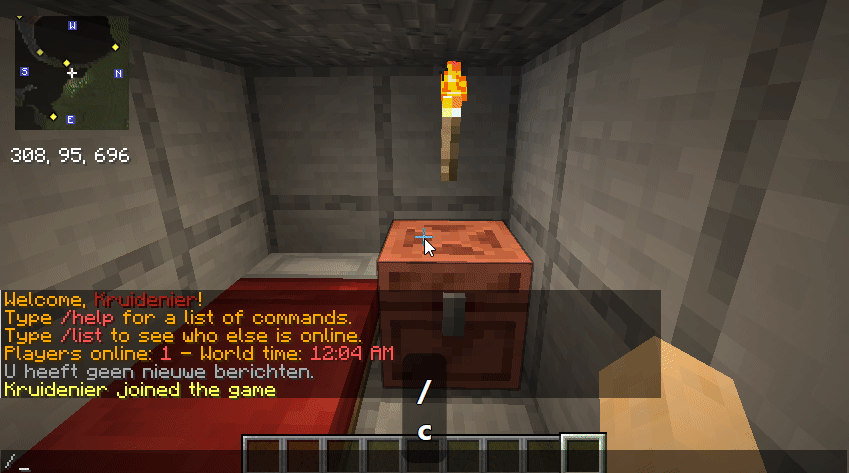
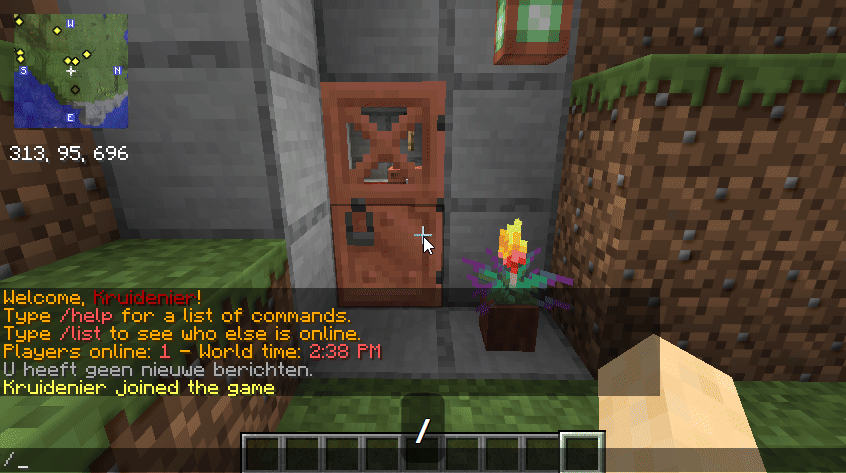
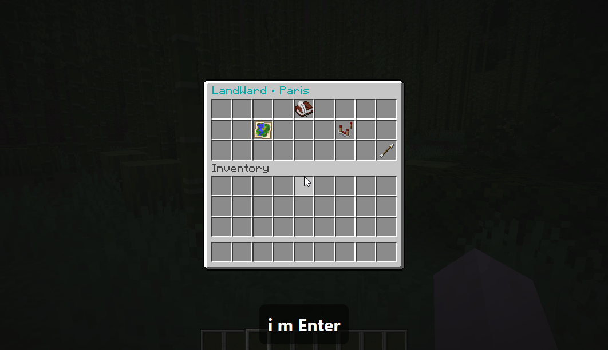
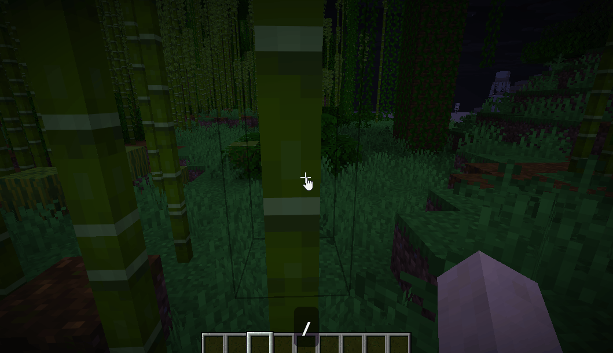
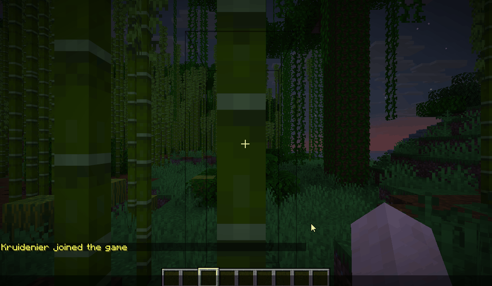
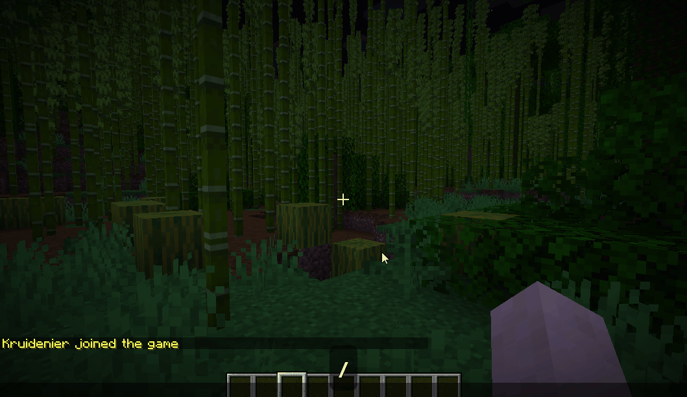
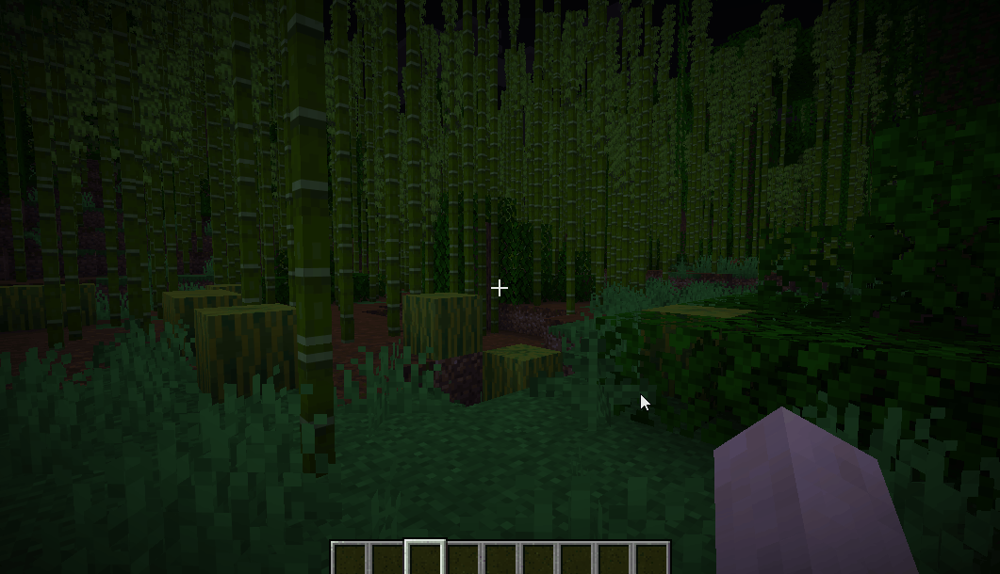

# LandWard

LandWard 1.0.5.0 adds Folia and CraftBukkit support in one universal JAR,
with region-safe warps and preserved clickable chat. See the [Wiki](https://github.com/DEVKruidenier/LandWard/wiki)
for configuration and guidance.

**Simple land claims. Reliable survival protection.**

LandWard is a GUI-first chunk-claim plugin for Paper, Purpur, Bukkit, Folia and Spigot survival servers.
For the complete feature list, commands and configuration guidance, visit the
[LandWard Wiki](https://github.com/DEVKruidenier/LandWard/wiki).

**Supported servers:**

- Paper 26.2 / 26.3
- Purpur 26.2 / 26.3
- Bukkit (CraftBukkit) 26.2 / 26.3
- Folia 26.2 / 26.3
- Spigot 26.2 / 26.3

Java 25 required.

**Velocity compatibility:** LandWard runs on a supported backend server behind Velocity. Install LandWard in the backend server's `plugins/` folder.

## Languages

**English is the default language.** LandWard automatically uses a supported
Minecraft client language when enabled. Server owners can change the default
and console language in `config.yml` and customize all text in `lang/<locale>.yml`.

**32 supported languages:** Arabic, Brazilian Portuguese, Czech, Danish, Dutch, English, Faroese, Filipino, Finnish, French, German, Hindi, Hungarian, Icelandic, Indonesian, Italian, Japanese, Korean, Malay, Norwegian Bokmål, Norwegian Nynorsk, Polish, Romanian, Russian, Simplified Chinese, Spanish, Swedish, Thai, Traditional Chinese, Turkish, Ukrainian and Vietnamese.

See [Languages and locale codes](https://github.com/DEVKruidenier/LandWard/wiki/Languages) for setup and automatic fallback behavior.

## Servers using LandWard

- **play.martialcraft.nl**
- Want your server listed here? Join **play.martialcraft.nl** and use
  `/mail send Kruidenier <yourServerIP>`.

## See it in action

**Create a land** — open `/claim`, choose **Create land**, and enter the land name
in the native Minecraft anvil interface.

**Claim map** — open the visual map centred on your current chunk, then click an
available neighbouring chunk to protect it.

**Player claim settings** — configure the land-wide protection defaults and
member permissions from the in-game settings menu.

**Administration menu** — open ClaimAdmin to review player lands, manage Safe
Zones and configure active worlds.

**Player claim administration** — select a player's land, inspect its claim map,
add or remove individual chunks, or remove the complete land after confirmation.

**Safe Zone settings** — configure building, entities, containers, doors,
interactions, mobs and PvP for server-owned areas, with individual member rights.
World and WorldGuard PvP restrictions remain authoritative.

**Active worlds** — enable or disable LandWard per world without changing the
server's other worlds.

