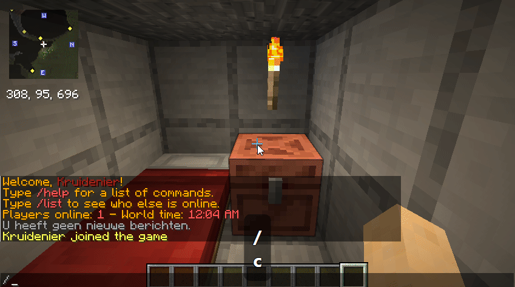
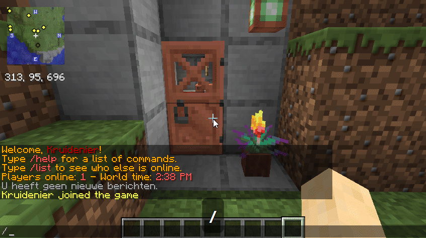

# LandWard

**Simple land claims. Reliable survival protection.**

LandWard is a GUI-first chunk-claim plugin for Paper and Spigot survival servers.
For the complete feature list, commands and configuration guidance, visit the
[LandWard Wiki](https://github.com/DEVKruidenier/LandWard/wiki).

## See it in action

**Create a land** — open `/claim`, choose **Create land**, and enter the land name
in the native Minecraft anvil interface.

**Claim map** — open the visual map centred on your current chunk, then click an
available neighbouring chunk to protect it.

