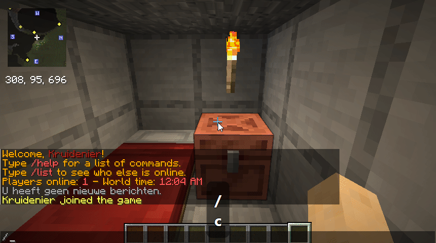
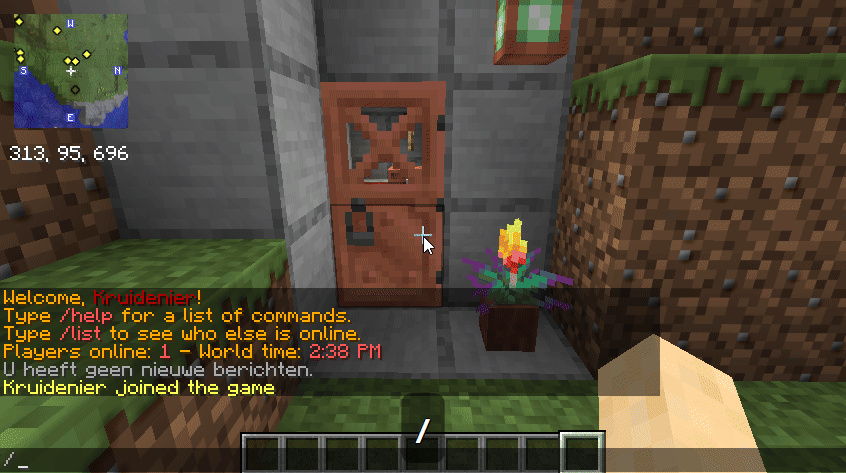
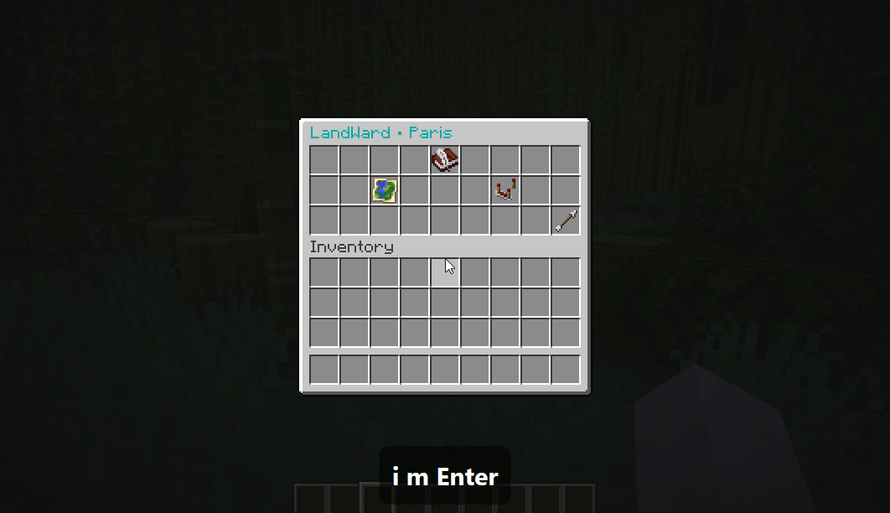
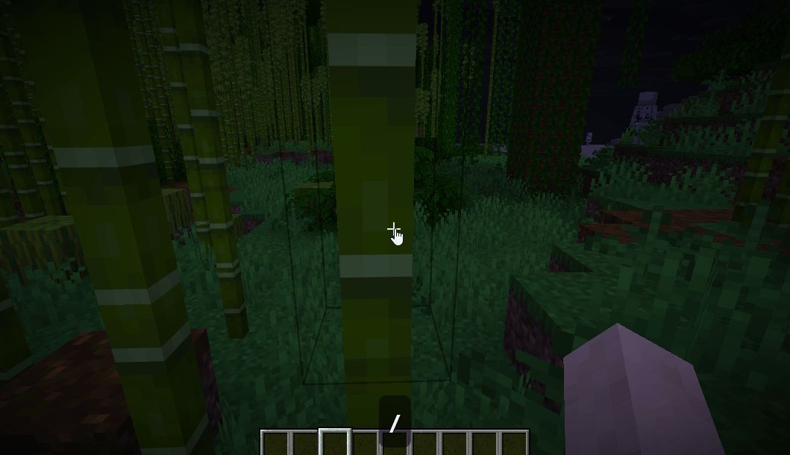
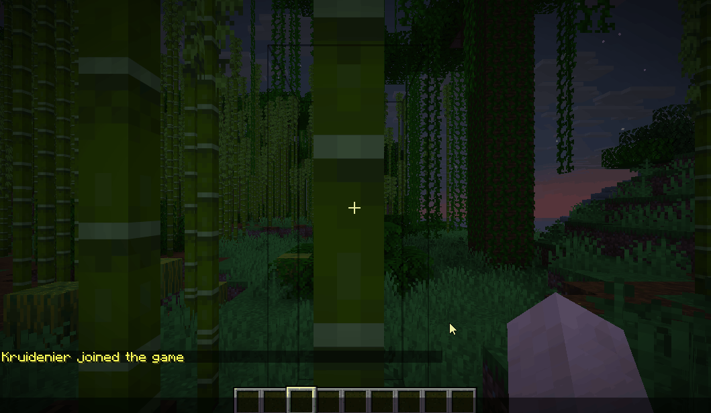
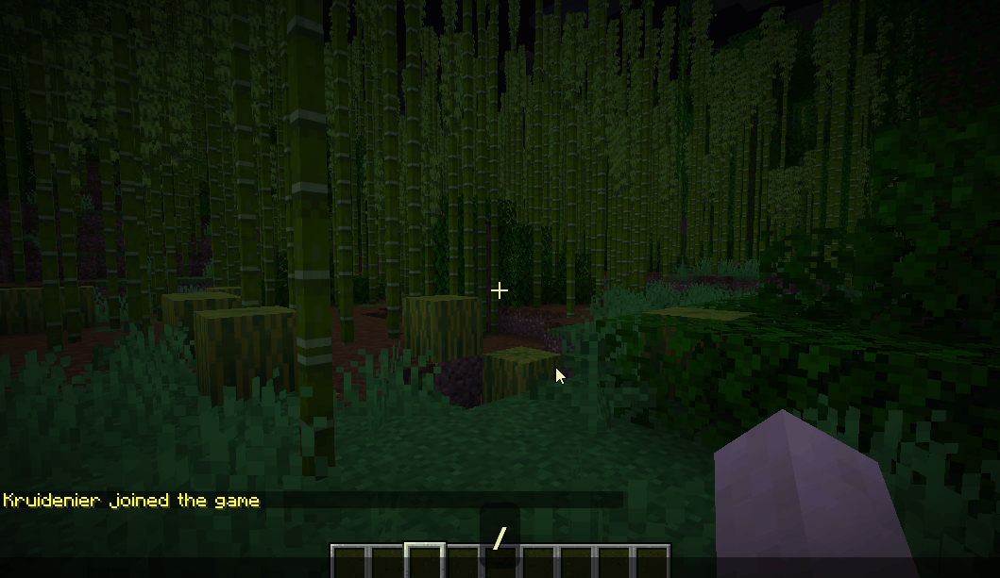
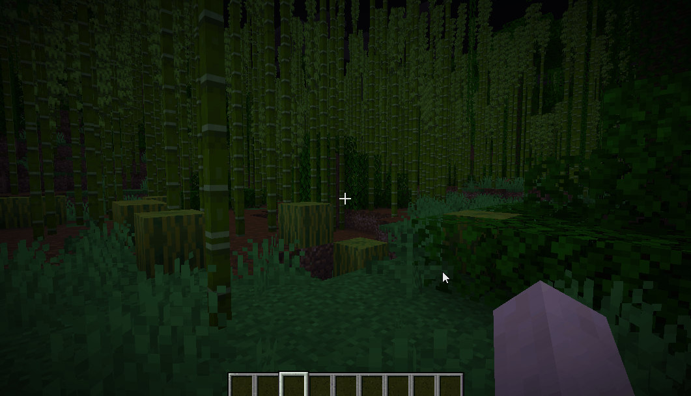

# LandWard

**Simple land claims. Reliable survival protection.**

LandWard is a GUI-first chunk-claim plugin for Paper and Spigot survival servers. Players
create a named land, open a visual chunk map and click the chunks they want to
protect—no golden shovel, selection wand or claim shop required.

## Highlights

- Visual chunk map centred on the player's current chunk.
- Player lands with member management and configurable member rights.
- Dedicated administrator tools for player-claim moderation and Safe Zones.
- Optional SQLite or MySQL/MariaDB storage with live migration tools.
- Optional Vault economy, WorldGuard, BlueMap, Squaremap, Pl3xMap, Plan,
  PlaceholderAPI, bStats and combat-tagger integrations.
- Localized player-facing messages and configurable protection behaviour.

## See it in action

**Create a land** — open `/claim`, choose **Create land**, and enter the land name
in the native Minecraft anvil interface.

**Claim map** — open the visual map centred on your current chunk, then click an
available neighbouring chunk to protect it.

**Player claim settings** — configure the land-wide protection defaults and
member permissions from the in-game settings menu.

**Administration menu** — open ClaimAdmin to review player lands, manage Safe
Zones and configure active worlds.

**Player claim administration** — select a player's land, inspect its claim map,
add or remove individual chunks, or remove the complete land after confirmation.

**Safe Zone settings** — configure building, entities, containers, doors,
interactions, mobs and PvP for server-owned areas, with individual member rights.
World and WorldGuard PvP restrictions remain authoritative.

**Active worlds** — enable or disable LandWard per world without changing the
server's other worlds.

## Requirements

- Paper or Spigot 26.2 or newer
- Java 25 or newer

For the complete feature list and detailed usage instructions, see the
[LandWard Wiki](https://github.com/DEVKruidenier/LandWard/wiki).

## Documentation and support

- [Installation, configuration and commands](https://github.com/DEVKruidenier/LandWard/wiki)
- [Report an issue](https://github.com/DEVKruidenier/LandWard/issues)
- [Source code](https://github.com/DEVKruidenier/LandWard)

LandWard is licensed under GPL-3.0-or-later.
